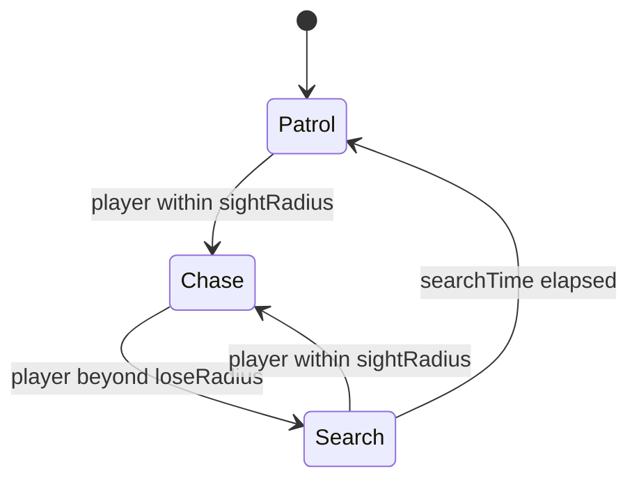
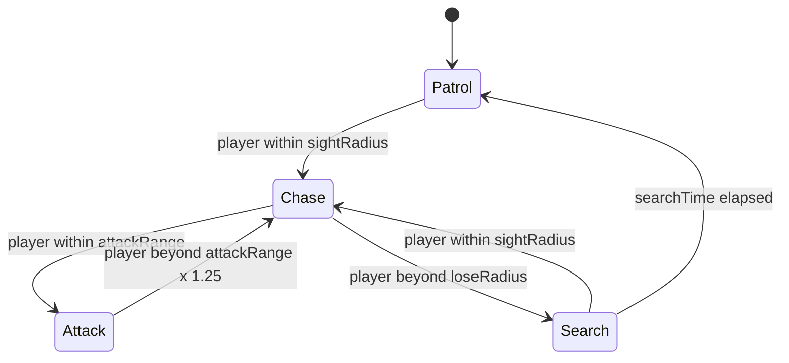

# Lesson: Finite State Machines with a guard enemy (2 hours)

**Scene:** `Assets/Scenes/3_FSM/FSM_Guard.unity`
**Provided (nobody types it):** `Assets/Scripts/FSM/GuardBody.cs`
**`Assets/Scripts/FSM/GuardAI.cs`:** ships as the **finished** guard (so the scene works out of the box). For class, replace it with the empty starter, `Docs/lesson-fsm/0_starter.cs.txt`
**Finished versions of every step:** `Docs/lesson-fsm/*.cs.txt`

## What students end with

A guard in a small arena. It patrols a rectangle (green), chases the player when they come close (red), strikes when touching distance is reached (magenta, white flash), gives up when the player gets far away, stands still looking around for 3 seconds (yellow), then goes back to patrolling.

They build it twice: first with an `enum` and a `switch` (one script, three states), then they refactor to **state classes**, and finally add a fourth state to feel how cheap that is.

## Goals

By the end students can:

1. Say what a state, a transition, a condition and an entry action are, and draw the state diagram of a behavior.
2. Build a working enemy FSM with an `enum` and a `switch`.
3. Explain hysteresis (two radii) and why it stops state flicker.
4. Say what is wrong with a growing `switch`, and refactor it to one class per state (`Enter` and `Tick`).
5. Add a new state by writing one new class and changing one line elsewhere.

## The one design decision to explain up front

The guard's **body** (movement, senses, colors, the label above its head) is already written in `GuardBody.cs`. Students only write the **brain**: `GuardAI : GuardBody`, which decides *what to do next*. This class is about decisions, not about movement (they did steering and navigation in earlier classes). It also means the Phase 1 to Phase 2 refactor touches only `GuardAI`.

| Member of `GuardBody` | What it does |
|---|---|
| `DistanceToPlayer` | Distance to the player (infinite if there is no player) |
| `PlayerPosition` | Where the player is |
| `MoveToward(target, speed)` | Walk toward a point. Returns `true` once arrived |
| `Stop()` | Stand still |
| `PatrolPoint` | The patrol point the guard is heading for |
| `NextPatrolPoint()` | Advance to the next patrol point, wrapping around |
| `GoToNearestPatrolPoint()` | Pick the closest patrol point as the next target |
| `Show(label, color)` | Tint the guard and write the state name above it |
| `Flash()` | A quick white blink |
| `walkSpeed`, `chaseSpeed`, `sightRadius`, `loseRadius`, `attackRange`, `attackCooldown`, `searchTime` | Inspector numbers, public so every state can read them |

**Rules for `GuardAI`:** use `Start` and `FixedUpdate` freely. Do **not** declare `Awake`, `OnValidate`, `OnGUI` or `OnDrawGizmosSelected`: `GuardBody` already uses them, and Unity would silently run only yours.

## What has been verified (Unity 6000.3.24f1)

- **Compiled without errors:** every rescue file (`1` to `5`) and the in-between state of Step 4 (the old `switch` and the new `State` classes side by side), each pasted over `GuardAI.cs`. The starter (`0_starter`) itself compiles and `FSM_Guard.unity` loads with `GuardAI` attached and the four patrol points assigned.
- **Play-tested** by moving the Player with a script (not by hand): the finished Part 1 (`3_search`): patrol, chase, search standing still for the full `searchTime`, back to patrol, and re-chase when the player returns during Search. The finished lesson (`5_attack`): patrol, chase, attack with the white flash at distance 0.9, then search and patrol again.
- **Not play-tested:** the intermediate versions `1_patrol`, `2_chase` and `4_state_classes` (they compile; their behavior is a subset of the versions above), the hysteresis demo, typing speed, and the Inspector click paths (changing Lose Radius in Play mode). Do the dress rehearsal.

## Preparation (about 10 minutes, the day before)

0. **Make the starter:** paste `Docs/lesson-fsm/0_starter.cs.txt` over `GuardAI.cs` (the project ships the finished version, which is also the answer key; do this on your class machine or a throwaway branch, and do not commit it). Without it students would start from the solution.
1. Open `FSM_Guard.unity`. Select `Guard`: it has `GuardAI` with **Patrol Points** = `Point_1` to `Point_4` already assigned. Nothing else to build in class.
2. **Gizmos** button ON in the Game view toolbar (the red and orange sight circles show when `Guard` is selected). Console docked with *Clear on Play* ON. *Maximize On Play* OFF.
3. Keep `Docs/lesson-fsm/` open in a text editor tab for the rescue files, and the state diagram on a slide or the board.
4. **Dress rehearsal** (strongly recommended): do the whole lesson once alone with a timer.
5. Reset after any run-through: `git restore Assets/Scripts/FSM/GuardAI.cs` (back to the finished guard), then repeat step 0 for the next class.

Press Play once before class and check the player moves with WASD without drifting (unplug game controllers; click inside the Game view first).

## Timeline

| Time | Block |
|---|---|
| 0:00 - 0:10 | Theory: the diagram on the board |
| 0:10 - 0:15 | Tour of the scene and of `GuardBody` |
| 0:15 - 0:30 | **Step 1**: `enum`, `Change`, Patrol |
| 0:30 - 0:45 | **Step 2**: Chase, then the hysteresis demo |
| 0:45 - 0:55 | **Step 3**: Search (a timer as an entry action) |
| 0:55 - 1:05 | What hurts |
| 1:05 - 1:35 | **Part 2**: refactor to state classes (steps 4 to 6) |
| 1:35 - 1:55 | Exercise: add Attack |
| 1:55 - 2:00 | Recap and what comes next |

There is no slack. If you are behind at 0:55, see *If you run late* at the end.

---

## 0:00 Theory (10 min)

Ask: "How would you code an enemy that patrols, chases you, and gives up?" Collect the pile of `if`s on the board, then say:

> At any moment the enemy is in **exactly one state**, and only a small set of **conditions** can move it to another state.

Draw this and keep it up all lesson:



Write four words next to it: **state** (what it is doing), **transition** (an arrow), **condition** (the label on the arrow), **entry action** (what happens once, on arrival).

## 0:10 Tour (5 min)

Press Play: the player walks with WASD, the guard (a white disc) stands still. In the Hierarchy: `Floor` and `Walls`, `PatrolPoints` (four empty objects marking the route in walking order), `Player` (tagged `Player`), `Guard`. Open `GuardBody.cs` and read only the public members from the table above. Say: "The guard knows how to walk, see and show a color. It has no brain. We write the brain."

---

# Part 1: enum + switch

## Step 1: Patrol (15 min)

**Teach:** an `enum` lists the states, one variable holds the current one, and every change goes through one method so entry actions have one home.

Open `GuardAI.cs`. Select all and replace the file with this. Type it in three chunks (the enum and the field, then `FixedUpdate`, then `Change`) but save once at the end:

```csharp
using UnityEngine;

public enum GuardState { Patrol, Chase, Search }

public class GuardAI : GuardBody
{
    private GuardState _state;

    private void Start() => Change(GuardState.Patrol);

    private void FixedUpdate()
    {
        switch (_state)
        {
            case GuardState.Patrol:
                if (MoveToward(PatrolPoint, walkSpeed))
                    NextPatrolPoint();
                break;
        }
    }

    // Every state change goes through here, so entry actions live in one place.
    private void Change(GuardState next)
    {
        _state = next;

        switch (next)
        {
            case GuardState.Patrol:
                Show("Patrol", Color.green);
                GoToNearestPatrolPoint();
                break;
        }
    }
}
```

Say: `FixedUpdate` only asks "which state am I in?" and dispatches. `MoveToward` returns `true` when the guard has arrived, and then we aim at the next point. `Change` is the **only** place the state changes: it records the state and runs the entry actions (color, label, pick the nearest route point).

**Check:** Console 0 errors. Press Play: the guard is **green**, labeled `Patrol`, and walks the rectangle forever. The player is ignored.
**Rescue file:** `1_patrol.cs.txt`.

## Step 2: Chase and hysteresis (15 min)

**Teach:** a transition is an `if` inside the state you are leaving. Check transitions first, then act.

Change the `Patrol` case, add the `Chase` case, and add the `Chase` entry action:

```csharp
            case GuardState.Patrol:
                if (DistanceToPlayer <= sightRadius)
                    Change(GuardState.Chase);
                else if (MoveToward(PatrolPoint, walkSpeed))
                    NextPatrolPoint();
                break;

            case GuardState.Chase:
                if (DistanceToPlayer > loseRadius)
                    Change(GuardState.Patrol);          // Search will replace this target in step 3
                else
                    MoveToward(PlayerPosition, chaseSpeed);
                break;
```

and in `Change`:

```csharp
            case GuardState.Chase:
                Show("Chase", Color.red);
                break;
```

**Check:** Play. Walk into the red circle: the guard turns red and chases. Run beyond the orange circle: it gives up, turns green and walks to the nearest route point.
**Rescue file:** `2_chase.cs.txt`.

### Hysteresis demo (about 5 min)

Select `Guard`, and in Play mode set **Lose Radius = 3** (equal to Sight Radius). Let the guard chase you, then hover about 3 units in front of it (step toward it, step away). The color flips red/green over and over, because the same distance both starts and ends the chase. Put Lose Radius back to `5.5`: the same hovering now gives one clean chase.

Say: "Two thresholds, a small one to enter and a bigger one to leave, stop a state from flickering at its border. That is **hysteresis**."

## Step 3: Search (10 min)

**Teach:** an entry action can start a timer. The guard should not walk home the instant it loses you; it looks around first.

Add a field next to `_state`:

```csharp
    private float _searchEnd;
```

Point Chase's give-up at Search, and add the `Search` case in `FixedUpdate`:

```csharp
            case GuardState.Chase:
                if (DistanceToPlayer > loseRadius)
                    Change(GuardState.Search);          // one word changed
                else
                    MoveToward(PlayerPosition, chaseSpeed);
                break;

            case GuardState.Search:
                if (DistanceToPlayer <= sightRadius)
                    Change(GuardState.Chase);
                else if (Time.time >= _searchEnd)
                    Change(GuardState.Patrol);
                break;
```

and the entry action in `Change`:

```csharp
            case GuardState.Search:
                Show("Search", Color.yellow);
                Stop();
                _searchEnd = Time.time + searchTime;
                break;
```

**Check:** Play. Red, then yellow and standing still for 3 seconds, then green and walking. Step back into the red circle while it is yellow: it chases again.
**Rescue file:** `3_search.cs.txt` (this is the finished Part 1).

## 0:55 What hurts (10 min)

Stop typing. Ask: "Where would the code for a fourth state go?" Walk through `GuardAI.cs` and collect:

- `_searchEnd` lives in `GuardAI` although only Search uses it. Eight states would mean eight stray variables, side by side.
- Every state is in **two** places: its behavior in `FixedUpdate`, its entry action in `Change`. Plus the `enum`.
- A new state means touching the enum, `FixedUpdate`, `Change` and the field list. The two `switch`es only grow.

Then the idea, on the board: **each state becomes a small class that owns its behavior, its entry action and its own data.** The machine just asks the current state to run.

---

# Part 2: state classes

## Step 4: the base class and the machine (5 min)

Add these to `GuardAI.cs`. First, inside the `GuardAI` class, next to the other fields and methods:

```csharp
    private State _current;

    public void Change(State next)
    {
        _current = next;
        _current.Enter(this);
    }
```

Then, below the `GuardAI` class (after its closing brace), a new class:

```csharp
public abstract class State
{
    public virtual void Enter(GuardAI g) { }
    public abstract void Tick(GuardAI g);
}
```

Say: `Enter` runs once when we arrive, `Tick` runs every physics step while we are here. Two methods called `Change` can coexist because their parameters differ; the old one goes away in step 6. Save: 0 errors, and the game still plays exactly as before (nothing uses the new code yet).

## Step 5: port the three states (15 min)

Below `State`, add one class per state. **Teacher types `PatrolState` live; students port `ChaseState` and `SearchState` themselves.**

The port is mechanical, so say the rules out loud:

| In the switch version | In the state class |
|---|---|
| The code inside `case X:` in `FixedUpdate` | the body of `Tick` |
| The code inside `case X:` in `Change` | the body of `Enter` |
| A field only that state uses (`_searchEnd`) | a private field of the state class (`_end`) |
| `Change(GuardState.Chase)` | `g.Change(new ChaseState())` |
| A call to a `GuardBody` member (`DistanceToPlayer`, `walkSpeed`, ...) | the same, prefixed with `g.` |

```csharp
public class PatrolState : State
{
    public override void Enter(GuardAI g)
    {
        g.Show("Patrol", Color.green);
        g.GoToNearestPatrolPoint();
    }

    public override void Tick(GuardAI g)
    {
        if (g.DistanceToPlayer <= g.sightRadius)
            g.Change(new ChaseState());
        else if (g.MoveToward(g.PatrolPoint, g.walkSpeed))
            g.NextPatrolPoint();
    }
}

public class ChaseState : State
{
    public override void Enter(GuardAI g) => g.Show("Chase", Color.red);

    public override void Tick(GuardAI g)
    {
        if (g.DistanceToPlayer > g.loseRadius)
            g.Change(new SearchState());
        else
            g.MoveToward(g.PlayerPosition, g.chaseSpeed);
    }
}

public class SearchState : State
{
    private float _end;

    public override void Enter(GuardAI g)
    {
        g.Show("Search", Color.yellow);
        g.Stop();
        _end = Time.time + g.searchTime;
    }

    public override void Tick(GuardAI g)
    {
        if (g.DistanceToPlayer <= g.sightRadius)
            g.Change(new ChaseState());
        else if (Time.time >= _end)
            g.Change(new PatrolState());
    }
}
```

Save: 0 errors. The game still runs the old `switch`; the new classes are not used yet.

**Teaching point (fresh objects):** `new ChaseState()` makes a brand new object at every transition. Its fields start fresh, so a timer can never be stale from the previous visit. The cost is one tiny allocation per transition, which is irrelevant here. (In a production game you would cache the states.)

## Step 6: flip the switch (10 min)

The satisfying moment. In `GuardAI`:

1. `Start` becomes `private void Start() => Change(new PatrolState());`
2. `FixedUpdate` becomes `private void FixedUpdate() => _current.Tick(this);`
3. **Delete**: the `GuardState` enum, `_state`, `_searchEnd`, the old `Change(GuardState next)` method, and the whole old `switch`.

`GuardAI` is now this, and nothing else:

```csharp
public class GuardAI : GuardBody
{
    private State _current;

    private void Start() => Change(new PatrolState());

    private void FixedUpdate() => _current.Tick(this);

    public void Change(State next)
    {
        _current = next;
        _current.Enter(this);
    }
}
```

**Check:** Play. Identical behavior: green, red, yellow, green. We deleted about 50 lines and nothing changed for the player.
**Rescue file:** `4_state_classes.cs.txt` (this is the finished Part 2).

Say: the whole state machine is three lines (`_current`, `Tick`, `Change`). All the knowledge lives in the states, and each transition sits in the state it leaves.

---

## 1:35 Exercise: add Attack (20 min)

Students add a fourth state alone or in pairs. Give them the table, nothing else:

| Item | Rule |
|---|---|
| New class | `AttackState : State`, color magenta, label `"Attack"` |
| `Enter` | `Stop()`; remember `_nextStrike = Time.time` so a fresh visit strikes straight away |
| `Tick` | every `attackCooldown` seconds call `g.Flash()` and push `_nextStrike` forward |
| Chase to Attack | `DistanceToPlayer <= attackRange` (one new line in `ChaseState.Tick`) |
| Attack to Chase | `DistanceToPlayer > attackRange * 1.25` (**hysteresis again**: leave at a bigger distance than you entered at) |

**Check:** walk up to the guard: it stops, goes magenta, flashes white once per second. Step back: it chases again. Walk away: red, yellow, green.
**Solution:** `5_attack.cs.txt`.

**Debrief (the payoff):** "How many existing places did you edit, and how many new ones did you write?" Answer: **one new class, plus one added `else if` in `ChaseState`.** Ask them what the same change would have cost in the `switch` version (an enum value, a case in two places, a field).

Fast pairs can try, in order: **Alert** (stand still for one second and turn white before chasing); **Flee** (run away from the player for two seconds when a key is pressed, then Search). Add `public virtual void Exit(GuardAI g) { }` to `State` and call it before `Enter` in `Change` if a state needs to clean up on the way out; that is the third method of a full state pattern, left out here because no state needed it.

## 1:55 Recap (5 min)

Show the finished diagram:



Three sentences to leave them with:

1. An FSM is: one current state, transitions as conditions, entry actions.
2. Two thresholds stop flicker (hysteresis).
3. When a `switch` starts to grow, give each state its own class.

**Where next:** behaviour trees and graph-based tools. This project already includes the Unity Behavior package; the same guard can be drawn as a graph there.

---

## If you run late

- **Behind at 0:55:** skip Step 3. Chase gives up to Patrol, so Part 1 is Patrol and Chase only. In Step 5 port just those two, then make **Search** the exercise instead of Attack (use the `SearchState` code above as the answer). Attack becomes homework.
- **Way behind:** paste `3_search.cs.txt` over `GuardAI.cs`, run it, and start at "What hurts".
- A student gets lost anywhere: paste the previous rescue file over `GuardAI.cs`. Every rescue file is a complete `GuardAI.cs`.

## Troubleshooting

| Symptom | Cause / fix |
|---|---|
| "The type or namespace name `GuardBody` could not be found" | `GuardBody.cs` is missing or has its own compile error |
| `Guard` shows **Missing (Mono Script)** | `GuardAI.cs` was renamed or deleted. The file must be called exactly `GuardAI.cs` |
| Guard stays white | `Start` does not call `Change(...)`, or `GuardAI` is not on the `Guard` |
| Guard stands still, one Console warning | Patrol Points are empty on the `Guard` |
| Guard never chases | Player is not tagged `Player`, or you are outside the red circle (turn Gizmos on) |
| Guard flickers at a distance | `Lose Radius` equals `Sight Radius`: put it back to 5.5 |
| `NullReferenceException` in `FixedUpdate` (Part 2) | `Start` still calls the old `Change(GuardState.Patrol)`, so `_current` is null. Use `Change(new PatrolState())` |
| Behavior is odd, Awake or OnGUI "does nothing" | `GuardAI` declared `Awake`, `OnValidate`, `OnGUI` or `OnDrawGizmosSelected` and hid the one in `GuardBody` |
| Attack never flashes | `attackRange` is smaller than the closest the two colliders can get (about 0.5 apart) |
| `attackRange` snaps to a smaller number | `GuardBody.OnValidate` keeps it at most `sightRadius` |
| Player drifts by itself | A game controller with stick drift is plugged in, or keyboard focus is not in the Game view |

## Appendix: Inspector values (already set in the scene)

| Object | Setting |
|---|---|
| `Guard` | Tag Untagged; Rigidbody 2D Gravity Scale 0, Freeze Rotation Z; Circle Collider 2D radius 0.3 |
| `GuardAI` | Patrol Points = `Point_1` to `Point_4` in order; Walk Speed 2; Chase Speed 3.5; Sight Radius 3; Lose Radius 5.5; Attack Range 1; Attack Cooldown 1; Search Time 3 |
| `Player` | Tag `Player`; Move Speed 5 |

## Notes for the teacher

- **Why `public` fields on `GuardBody`:** the state classes are separate classes and need to read the numbers. Plain public fields keep that readable for beginners.
- **Why `Return` is gone:** it was Patrol plus an entry action (pick the nearest route point). Patrol's `Enter` now does that, which is a design point worth saying once: a new state is only needed when the *behavior* differs.
- **Why `FixedUpdate`:** the guard moves a Rigidbody, so it decides on the physics step. Say it in one sentence and move on.
- **What is deliberately not covered:** `Exit`, hierarchical state machines, transition tables, ScriptableObject states, animation. Mention them only if asked.
